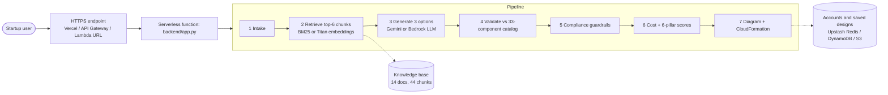

# CloudArch Advisor

**Generative AI-Based Cloud Architecture Recommendation Framework for Startup Enterprises using Retrieval-Augmented Generation**
BCSE355L Cloud Architecture Design · B2 slot · Project

**Team:** Sai Chandra Reddy (24BYB0011) · Manoj Kumar S (24BDE0052) · S M Nithin (24BDE0033)  
**Faculty:** Muthamil Selvan

**Live demo:** https://cloudarch-advisor.vercel.app

A startup describes its product, users, budget, team size and compliance needs. CloudArch Advisor returns three AWS
architectures (**Low-cost**, **Balanced**, **High-availability**), each with:

- GenAI reasoning grounded in AWS Well-Architected guidance (RAG), with the sources shown
- an estimated monthly cost and a budget check
- scores on the six Well-Architected pillars, plus a radar chart comparing the options
- an auto-generated architecture diagram (Mermaid)
- a downloadable **CloudFormation starter template** for the chosen option
- guardrails: invented services are rejected, compliance controls (HIPAA, PCI DSS, GDPR, SOC 2) are enforced

Also in the app:

- **Optional accounts** (sign up, sign in, or use it as a guest) with your designs saved for 30 days
- **Ask the architect**: follow-up questions about a design, answered with RAG and the LLM
- **Growth simulator**: projected monthly cost over 6–36 months and the month the budget is exceeded
- **Downloadable report** (PDF with page numbers, or Word) with the summary, comparison, diagrams, costs and the CloudFormation appendix
- A cost-by-layer chart, a **knowledge-base browser**, and light and dark themes
- If the AI model is slow or unavailable, a rule-based fallback still answers and the page says why
- **Rate limiting** per visitor: 5 designs a minute and 60 a day, 10 questions a minute, 10 sign-in attempts a minute

The LLM only **chooses and explains** components. Prices, scores, compliance rules, diagrams and IaC are produced by
deterministic, testable code.

## How it works



## Deploy it — three profiles, one code base

| | **Vercel** (easiest) | **AWS – full profile** | **AWS Academy lab profile** |
|---|---|---|---|
| Endpoint | Vercel function `api/index.py` | API Gateway HTTP API | Lambda Function URL |
| Compute | Vercel serverless (Python) | AWS Lambda | AWS Lambda |
| LLM | Google Gemini | Amazon Bedrock (Nova Lite) | Google Gemini |
| Retrieval | BM25 over `kb/` | Titan Text Embeddings V2 | BM25 |
| Accounts and saved designs | Upstash Redis | DynamoDB | S3 |
| Infra as code | `vercel.json` | `template.yaml` (CloudFormation) | `template.yaml` + `deploy.sh` auto-detects the lab |

### A. Vercel (from this GitHub repo)
1. Get a free Gemini API key at https://aistudio.google.com/apikey
2. https://vercel.com → **Add New… → Project** → import this repository
3. **Environment Variables:** `GEMINI_API_KEY` = your key (optional: `AUTH_SECRET` = any long random string)
4. **Deploy** → open the `*.vercel.app` link
5. Recommended, so accounts and designs survive restarts: Vercel project → **Storage** → **Upstash for Redis** →
   create (free plan, same region as your functions, usually Washington, D.C. `iad1`) → connect to the project → redeploy.
   The app finds the `KV_REST_API_URL` / `KV_REST_API_TOKEN` variables it adds, with or without a prefix.
   Check `https://<your-app>.vercel.app/api/health` shows `"persistent_store": true`. Without it, data is kept in memory.

### B. AWS (in AWS CloudShell, region us-east-1)
```bash
git clone https://github.com/sai-140307/cloudarch-advisor && cd cloudarch-advisor
bash deploy.sh                              # normal AWS account: Bedrock + API Gateway + DynamoDB
bash deploy.sh GeminiApiKey=YOUR_KEY        # AWS Academy sandbox (detected automatically)
bash teardown.sh                            # delete everything
```

### C. Your own computer
```bash
export GEMINI_API_KEY=your_key      # PowerShell: $env:GEMINI_API_KEY="your_key"
python3 scripts/run_local.py        # open http://localhost:8000
```
Python 3.10+ only, no packages needed.

## Project structure

| Path | What it is |
|---|---|
| `backend/app.py` | Request handler and routes (`/api/auth/*`, `/api/recommend`, `/api/history`, `/api/design/<id>`, `/api/ask`, `/api/kb`, `/api/health`) |
| `backend/auth.py` | Accounts: PBKDF2-SHA256 password hashing, signed session tokens |
| `backend/store.py` | Key-value store: Upstash Redis REST API, or in-memory fallback |
| `backend/rag.py` | Chunking, BM25 / Titan retrieval, index |
| `backend/llm.py` | Prompt, Gemini and Bedrock clients, model fallback chain |
| `backend/catalog.py` | 33 AWS components: cost per tier, pillar contributions, blueprints, compliance rules |
| `backend/engine.py` | Validation, guardrails, cost, pillar scoring, Mermaid diagram |
| `backend/iac.py` | CloudFormation starter-template generator |
| `backend/index.html` | Single-page web app: sign-in, wizard, results dashboard, report export |
| `kb/` | Knowledge base: 14 curated documents (6 pillars, patterns, DR, compliance, sizing, IaC) |
| `api/index.py`, `vercel.json` | Vercel deployment |
| `template.yaml`, `deploy.sh`, `teardown.sh` | AWS deployment (CloudFormation) |
| `scripts/evaluate.py` | Evaluation: 8 scenarios × RAG on/off |
| `scripts/run_local.py` | Run locally |

## Evaluation (20 Oct 2026, AWS Academy profile)

| Metric | RAG on | RAG off |
|---|---|---|
| Required-component coverage (LLM only, before guardrails) | **88%** | 68% |
| Invented services per option | 0.00 | 0.00 |
| Options within budget | 71% | 75% |
| Mean Well-Architected score (1–5) | 3.66 | 3.65 |
| Mean latency per request (s) | 46.8 | 23.7 |

21 of 48 options came from the rule-based fallback because of Gemini free-tier limits; coverage is computed over the 27
LLM-generated options. Run it yourself: `python3 scripts/evaluate.py <app URL>`.

## Tech stack

| Part | Technology |
|---|---|
| Backend | Python 3.12, standard library only (no pip packages) |
| AI | Google Gemini API (Flash, with Flash-Lite fallback) or Amazon Bedrock (Nova Lite, Titan Text Embeddings V2) |
| Retrieval | Okapi BM25 or Titan embeddings with cosine similarity, over 14 Markdown documents |
| Storage | Upstash Redis (Vercel), DynamoDB or S3 (AWS) |
| Hosting | Vercel serverless functions, or AWS Lambda behind API Gateway / Function URL |
| Infrastructure as code | AWS CloudFormation (`template.yaml`), `vercel.json` |
| Frontend | Single HTML page with vanilla JavaScript, Mermaid for diagrams, html2canvas + jsPDF for the PDF report |

## Limitations
- Prices are static, tier-based estimates for us-east-1; confirm them in the AWS Pricing Calculator
- Pillar scores use heuristic component weights, not a full Well-Architected review
- The knowledge base is 14 curated documents and covers AWS only
- Sign-in is optional; abuse protection is limited to per-visitor rate limits (no WAF)
- On the Gemini free tier, responses can be slow or rate-limited at busy times
