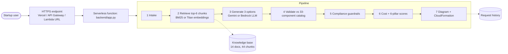

# CloudArch Advisor

**Generative AI-Based Cloud Architecture Recommendation Framework for Startup Enterprises using Retrieval-Augmented Generation**
BCSE355L Cloud Architecture Design · Project

A startup describes its product, users, budget, team size and compliance needs. CloudArch Advisor returns three AWS
architectures (**Low-cost**, **Balanced**, **High-availability**), each with:

- GenAI reasoning grounded in AWS Well-Architected guidance (RAG), with the sources shown
- an estimated monthly cost and a budget check
- scores on the six Well-Architected pillars, plus a radar chart comparing the options
- an auto-generated architecture diagram (Mermaid)
- a downloadable **CloudFormation starter template** for the chosen option
- guardrails: invented services are rejected, compliance controls (HIPAA, PCI DSS, GDPR, SOC 2) are enforced

The LLM only **chooses and explains** components. Prices, scores, compliance rules, diagrams and IaC are produced by
deterministic, testable code.

## How it works



## Deploy it — three profiles, one code base

| | **Vercel** (easiest) | **AWS – full profile** | **AWS Academy lab profile** |
|---|---|---|---|
| Endpoint | Vercel function `api/index.py` | API Gateway HTTP API | Lambda Function URL |
| Compute | Vercel serverless (Python) | AWS Lambda | AWS Lambda |
| LLM | Google Gemini | Amazon Bedrock (Nova Lite) | Google Gemini |
| Retrieval | BM25 over `kb/` | Titan Text Embeddings V2 | BM25 |
| History | in memory | DynamoDB | S3 |
| Infra as code | `vercel.json` | `template.yaml` (CloudFormation) | `template.yaml` + `deploy.sh` auto-detects the lab |

### A. Vercel (from this GitHub repo)
1. Get a free Gemini API key at https://aistudio.google.com/apikey
2. https://vercel.com → **Add New… → Project** → import this repository
3. **Environment Variables:** `GEMINI_API_KEY` = your key
4. **Deploy** → open the `*.vercel.app` link

### B. AWS (CloudShell)
```bash
unzip cloud-arch-advisor.zip && cd cloud-arch-advisor
bash deploy.sh                              # normal AWS account: Bedrock + API Gateway + DynamoDB
bash deploy.sh GeminiApiKey=YOUR_KEY        # AWS Academy sandbox (detected automatically)
bash teardown.sh                            # delete everything
```

### C. Your own computer
```bash
export GEMINI_API_KEY=your_key      # PowerShell: $env:GEMINI_API_KEY="your_key"
python3 scripts/run_local.py        # open http://localhost:8000
```
Python 3.10+ only, no packages needed.

## Project structure

| Path | What it is |
|---|---|
| `backend/app.py` | Request handler and routes (`/`, `/api/recommend`, `/api/history`, `/api/health`) |
| `backend/rag.py` | Chunking, BM25 / Titan retrieval, index |
| `backend/llm.py` | Prompt, Gemini and Bedrock clients, model fallback chain |
| `backend/catalog.py` | 33 AWS components: cost per tier, pillar contributions, blueprints, compliance rules |
| `backend/engine.py` | Validation, guardrails, cost, pillar scoring, Mermaid diagram |
| `backend/iac.py` | CloudFormation starter-template generator |
| `backend/index.html` | Single-page web UI |
| `kb/` | Knowledge base: 14 curated documents (6 pillars, patterns, DR, compliance, sizing, IaC) |
| `api/index.py`, `vercel.json` | Vercel deployment |
| `template.yaml`, `deploy.sh`, `teardown.sh` | AWS deployment (CloudFormation) |
| `scripts/evaluate.py` | Evaluation: 8 scenarios × RAG on/off |
| `scripts/run_local.py` | Run locally |

## Evaluation (20 Oct 2026, AWS Academy profile)

| Metric | RAG on | RAG off |
|---|---|---|
| Required-component coverage (LLM only, before guardrails) | **88%** | 68% |
| Invented services per option | 0.00 | 0.00 |
| Options within budget | 71% | 75% |
| Mean Well-Architected score (1–5) | 3.66 | 3.65 |
| Mean latency per request (s) | 46.8 | 23.7 |

21 of 48 options came from the rule-based fallback because of Gemini free-tier limits; coverage is computed over the 27
LLM-generated options. Run it yourself: `python3 scripts/evaluate.py <app URL>`.

## Limitations
Static, tier-based price estimates (us-east-1, verify in the AWS Pricing Calculator) · heuristic pillar weights ·
14 curated documents · AWS only · public endpoint without authentication.
